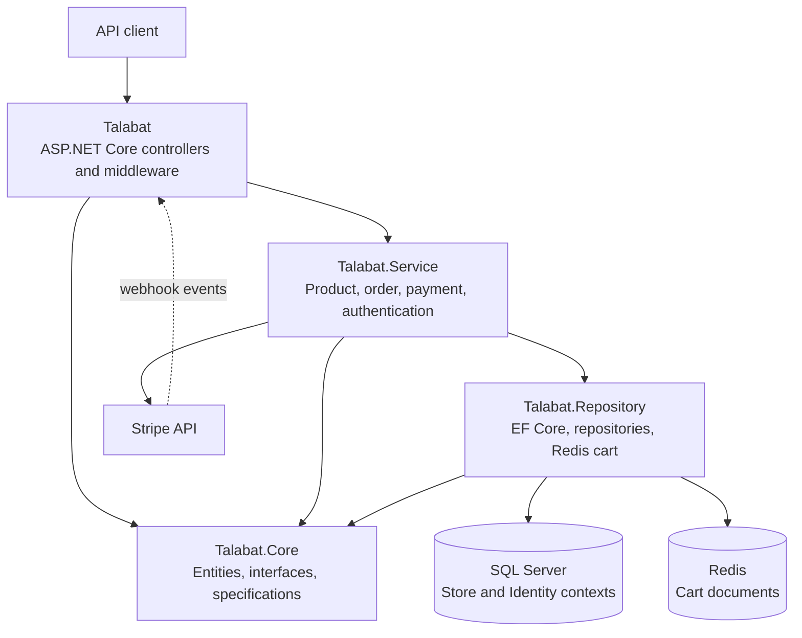

# Talabat Backend API

An ASP.NET Core Web API for an e-commerce application. The API provides product discovery, account and address management, Redis-backed shopping carts, order workflows, and Stripe PaymentIntent integration. It is organized as a multi-project .NET solution with separate API, domain, service, and persistence projects.

## Contents

- [Features](#features)
- [Technology stack](#technology-stack)
- [Architecture](#architecture)
- [Solution structure](#solution-structure)
- [Data model](#data-model)
- [API overview](#api-overview)
- [Authentication and authorization](#authentication-and-authorization)
- [Integrations](#integrations)
- [Prerequisites](#prerequisites)
- [Local setup](#local-setup)
- [Configuration](#configuration)
- [Database initialization](#database-initialization)
- [Run the API](#run-the-api)
- [Tests](#tests)
- [Screenshots](#screenshots)
- [License](#license)

## Features

- Browse products, brands, and categories.
- Filter, search, sort, and paginate product and employee listings.
- Register and log in with email and password; receive a JWT.
- Retrieve and update a user's saved address.
- Create and update shopping carts stored in Redis with a 30-day expiry.
- Create orders from cart contents and a selected delivery method; list and retrieve the signed-in user's orders.
- Create or update Stripe PaymentIntents and process payment success/failure webhook event types.
- Serve product images from the API's `wwwroot` static files directory.
- Explore the API with Swagger in the Development environment.

## Technology stack

| Area | Technology |
| --- | --- |
| Runtime and web API | C#, .NET 8, ASP.NET Core Web API |
| Relational persistence | Entity Framework Core 8, SQL Server |
| User management | ASP.NET Core Identity |
| API authentication | JWT Bearer |
| Cart persistence | Redis via StackExchange.Redis |
| Payments | Stripe.net PaymentIntents |
| Object mapping | AutoMapper |
| API documentation UI | Swagger via Swashbuckle (Development only) |

## Architecture

The solution separates HTTP handling, domain contracts, business workflows, and persistence. Controllers use services for product, order, payment, and authentication workflows. The services use repository abstractions and a Unit of Work to access relational data. Query specifications centralize filtering, includes, ordering, and pagination.



The code follows a layered design with repository, Unit of Work, and specification patterns. Although the existing project has described itself as Onion Architecture, the current project references include `Talabat.Service` referencing `Talabat.Repository`; this dependency direction is not a strict inward-only onion dependency model.

## Solution structure

```text
Talabat.sln
├── Talabat/                         # ASP.NET Core API, controllers, DTOs, middleware
│   ├── Controllers/                 # Account, cart, employee, order, payment, product
│   ├── Dtos/                        # Request and response models
│   ├── Extentions/                  # Dependency registration and startup seeding
│   ├── Helpers/                     # Mapping, pagination and response helpers
│   └── wwwroot/images/products/     # Static product images
├── Talabat.Core/                    # Domain entities and service/repository contracts
│   ├── Entities/                    # Catalog, employee, cart, identity and order models
│   ├── IRepositories/               # Repository contracts
│   ├── IServices/                   # Service contracts
│   └── Specifications/              # Product, employee and order query rules
├── Talabat.Repository/              # Persistence and data access implementations
│   ├── Data/                        # StoreContext, EF configurations, migrations, JSON seeds
│   ├── Identity/                    # Identity context and migrations
│   └── CartRepository.cs            # Redis cart persistence
└── Talabat.Service/                 # Product, order, payment and authentication services
```

## Data model

`StoreContext` manages catalog, employee, and order data. `ApplicationIdentityDbContext` manages ASP.NET Identity data and the user's saved address.

Important entities and relationships:

- `Product` references `Brand` and `Category`.
- `Employee` references `Department`.
- `Order` belongs to a customer email, references a `DeleveryMethod`, and contains `OrderItem` records.
- Each `OrderItem` stores an `OrderedItemProduct` snapshot (product ID, name, and image URL) alongside its price and quantity.
- The order shipping address is an owned value in the order context. Identity's saved address is a separate entity associated with `ApplicationUser`.
- `CustomerCart` and its `CartItem` values are stored as serialized JSON in Redis, not in SQL Server.

EF Core configurations and migrations are included for both SQL Server contexts. The application attempts to apply migrations and seed data at startup.

## API overview

Routes use the `api/[controller]` convention. Protected requests require `Authorization: Bearer <token>`. Product and employee endpoints are public.

| Method | Endpoint | Access | Purpose |
| --- | --- | --- | --- |
| `POST` | `/api/account/register` | Public | Register and return a token |
| `POST` | `/api/account/login` | Public | Log in and return a token |
| `GET` | `/api/account` | JWT | Return the current Identity user |
| `GET`, `PUT` | `/api/account/address` | JWT | Read or update the saved user address |
| `GET` | `/api/product` | Public | Search, filter, sort, and paginate products |
| `GET` | `/api/product/{id}` | Public | Get a product |
| `GET` | `/api/product/brands` | Public | List brands |
| `GET` | `/api/product/categories` | Public | List categories |
| `GET`, `POST`, `PUT`, `DELETE` | `/api/carts/{id}` or `/api/carts` | JWT | Read, store, update, or delete a Redis cart |
| `POST` | `/api/order` | JWT | Create an order from a cart |
| `GET` | `/api/order` | JWT | List the current user's orders |
| `GET` | `/api/order/{id}` | JWT | Get one of the current user's orders |
| `GET` | `/api/order/delivery-methods` | JWT | List delivery methods |
| `POST` | `/api/payment/{id}` | JWT | Create or update a payment intent for an order |
| `POST` | `/api/payment/webhook` | Public webhook | Handle supported Stripe payment intent events |
| `GET` | `/api/emplyee` | Public | Search/filter/sort/page employees |
| `GET` | `/api/emplyee/{id}` | Public | Get an employee query result by ID |

Product list query parameters include `PageIndex`, `PageSize` (maximum 5), `Sort` (`priceAsc`, `priceDesc`, `nameAsc`, `nameDesc`), `Search`, `BrandId`, and `CategoryId`. Employee listing supports `Search`, `DepartmentId`, `Sort` (`nameAsc`, `nameDesc`, `ageAsc`, `ageDesc`), `PageIndex`, and `PageSize` (zero defaults to 5). Order listing supports `PageIndex`, `PageSize` (maximum 5), and `Sort` (`dateAsc`, `dateDesc`, `subTotalAsc`, `subTotalDesc`).

### Example: register and create an order

Register with the required display name, username, email, password, and confirmation fields:

```http
POST /api/account/register
Content-Type: application/json

{
  "displayName": "Example User",
  "userName": "example-user",
  "phoneNumber": "+10000000000",
  "email": "user@example.com",
  "password": "ReplaceWithAValidPassword",
  "confirmPassword": "ReplaceWithAValidPassword"
}
```

The success response is a `UserDTO` containing `displayName`, `userName`, and `token`. Use that token for protected requests. For example, order creation accepts a cart ID, delivery method ID, and shipping address:

```http
POST /api/order
Authorization: Bearer <token>
Content-Type: application/json

{
  "cartId": "cart-id",
  "delevryMethodId": 1,
  "orderAddress": {
    "fName": "Example",
    "lName": "User",
    "street": "123 Example Street",
    "country": "Example Country",
    "depNumber": "123"
  }
}
```

Product listings return a `PaginationResponse` with `pageSize`, `pageIndex`, `count`, and `data`. A product query can be made as:

```http
GET /api/product?PageIndex=1&PageSize=5&Sort=priceAsc&Search=tea
```

## Authentication and authorization

ASP.NET Core Identity manages users and password verification. On registration and login, the API issues a signed JWT containing user identity claims, email, any configured user claims, and roles. JWT bearer validation checks the configured signing key, issuer, audience, and token expiry.

Account detail/address, cart, order, and payment operations are marked with `[Authorize]`. Product and employee reads are public. There is no refresh-token endpoint or OAuth provider in the current implementation. The Stripe webhook is anonymous and the code parses the event body without validating a Stripe signature; configure webhook signature verification before relying on it in a production environment.

The configured CORS policy allows any origin, header, and method. Cart endpoints accept a cart ID but do not bind that ID to the authenticated user's identity. Review both behaviors before exposing the API to untrusted clients.

## Integrations

- **SQL Server:** Separate store and Identity databases configured through connection strings.
- **Redis:** Stores carts as JSON under their cart ID with a 30-day expiry.
- **Stripe:** Creates and updates card PaymentIntents in USD. The webhook handles payment-intent success and failure event types.
- **Static product images:** Files are served from `wwwroot`; generated image URLs use the configured `BaseUrl`.

## Prerequisites

- .NET 8 SDK
- SQL Server reachable by the API
- Redis reachable by the API
- Stripe test or live credentials to exercise payment operations

## Local setup

From the repository root, restore the solution packages:

```bash
dotnet restore Talabat.sln
```

Configure the required settings as described below. The startup data seeder reads JSON files using paths relative to the API working directory. Run the API from the `Talabat` directory so those paths resolve as written:

```bash
cd Talabat
dotnet run
```

The HTTPS launch profile is configured for `https://localhost:7045` (HTTP: `http://localhost:5274`) and opens Swagger at `/swagger` in Development. The application also attempts to migrate both databases and seed data during startup.

## Configuration

Do not commit secrets or real connection strings. Supply settings through .NET configuration environment variables (double underscore `__` maps to a colon). The source expects these exact keys:

| Environment variable | Purpose |
| --- | --- |
| `ConnectionStrings__cs` | SQL Server connection string for `StoreContext` |
| `ConnectionStrings__IdentityCS` | SQL Server connection string for Identity |
| `ConnectionStrings__Redis` | Redis connection string |
| `JWT__SecurityKey` | Private key used to sign JWTs |
| `JWT__Audience` | Expected JWT audience |
| `JWT__Issure` | Expected JWT issuer (the configuration key is spelled `Issure` in source) |
| `JWT__DurationInDays` | JWT lifetime in days |
| `StripSettings__SecretKey` | Stripe secret key (the section is spelled `StripSettings` in source) |
| `BaseUrl` | Base URL used when constructing product image URLs |

For example, set these in your shell or deployment environment with your own local values. Keep the values private; the values below are placeholders only:

```text
ConnectionStrings__cs=<SQL Server connection string>
ConnectionStrings__IdentityCS=<Identity SQL Server connection string>
ConnectionStrings__Redis=<Redis connection string>
JWT__SecurityKey=<long random signing key>
JWT__Audience=<your JWT audience>
JWT__Issure=<your JWT issuer>
JWT__DurationInDays=5
StripSettings__SecretKey=<Stripe secret key>
BaseUrl=https://localhost:7045
```

The project currently has configuration files containing credential-like values, and `.gitignore` does not exclude `appsettings.json`. Before publishing or deploying, remove secrets from tracked configuration, use user secrets/environment variables/secret storage, and rotate any credentials that may have been exposed. Do not copy existing configuration values into documentation.

## Database initialization

On startup, `UseSeedingData` calls `MigrateAsync()` for both `StoreContext` and `ApplicationIdentityDbContext`, then seeds store JSON data and a source-defined Identity account if their respective stores are empty. Review or remove the source-defined account before production use. The source seeder catches and logs initialization errors, so a successful process start alone does not prove that database migration or seeding succeeded; inspect application logs and database state.

The migration files are under `Talabat.Repository/Data/Migrations` and `Talabat.Repository/Identity/Migrations`. No manual migration command is required for the normal startup path. If you choose to manage migrations manually, use the .NET EF tooling with `Talabat` as the startup project and select the appropriate context (`StoreContext` or `ApplicationIdentityDbContext`); the repository does not include a `dotnet-ef` tool manifest.

## Run the API

```bash
cd Talabat
dotnet run
```

For Development, Swagger is available at `https://localhost:7045/swagger` when using the HTTPS launch profile. In other environments, Swagger middleware is not enabled by this code.

## Tests

No test project or automated test suite is present in the repository at this time.

## Screenshots

This repository contains a backend API and no user interface screenshots.

## License

No license file or other repository declaration establishes a license. Add a license before presenting the project as open source under a particular license.
